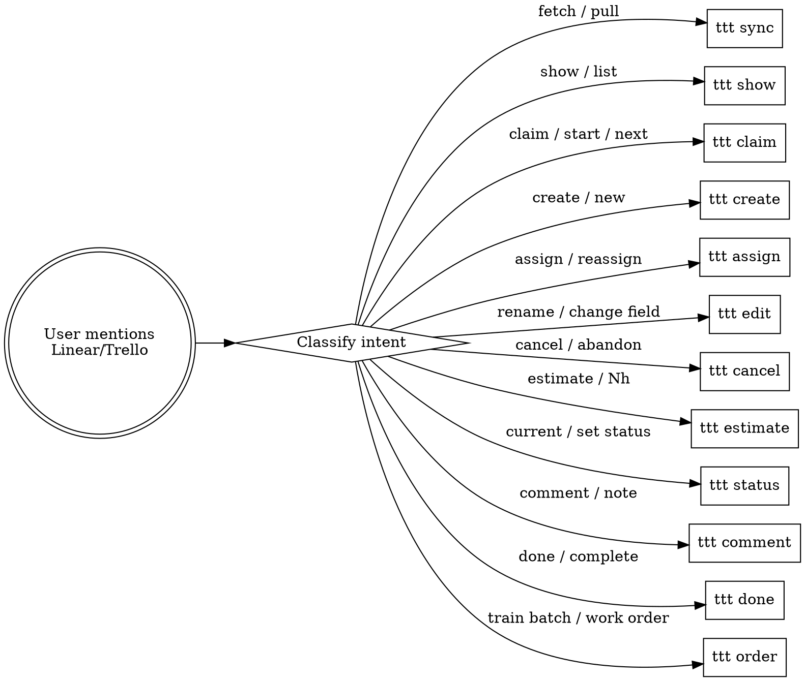

## 執行方式

在 Codex 與 Claude Code 中，使用可用的 shell 工具執行 `ttt` CLI。
任務資料以 CLI 的查詢結果為準；透過 CLI 更新 `.ttt/` 內的設定與狀態。
使用者要求完成任務時，執行 `ttt done -m "摘要"`。
Claude Code 也提供 `/ttt:*` slash commands，對應下方相同的 CLI 操作。


# Task Manager (Linear/Trello)

Manage developer task workflows using the `ttt` CLI.

## Command Router

依使用者意圖選擇下列 `ttt` CLI 指令：

| User Intent | Command | Example |
|-------------|---------|---------|
| Sync/fetch issues | `ttt sync` | "sync my issues", "pull from Linear" |
| Show/search issues | `ttt show` | "show MP-624", "list my tasks", "what issues do I have" |
| Claim ticket(s) → in-progress | `ttt claim` | "領票", "work on next", "start MP-624", "claim MP-624 MP-625" |
| Create a new issue | `ttt create` | "create issue", "open a ticket", "new task" |
| Reassign an issue | `ttt assign` | "assign MP-624 to john", "reassign to jane" |
| Edit issue fields | `ttt edit` | "rename MP-624", "change priority", "update labels" |
| Cancel an issue | `ttt cancel` | "cancel MP-624", "abandon this task" |
| Record an estimate | `ttt estimate` | "estimate MP-624 as 6h", "save 2.5h estimate" |
| Check/change status | `ttt status` | "what's my current task", "set MP-624 to blocked" |
| Add a comment | `ttt comment` | "comment on MP-624", "add note to task" |
| Complete task(s) | `ttt done` | "done", "mark complete", "finish task", "close MP-624 MP-625" |
| Track a train batch | `ttt order` | "開工單", "seal the order", "hand off the train", "close the batch after merge" |

**意圖符合時，透過 shell 工具執行對應的 `ttt` CLI 指令。**

## Quick Reference

```bash
ttt sync                    # Sync Todo/In Progress issues
ttt sync --all              # Sync all statuses
ttt sync MP-624             # Sync specific issue
ttt show                    # List all local issues
ttt show MP-624             # Show issue details
ttt show --user me          # My issues
ttt show --remote --status Backlog --creator me  # Backlog tickets I created (any cycle)
ttt show --remote --status Backlog --user me     # Backlog tickets assigned to me
ttt claim next              # Claim highest priority pending task
ttt claim next 3            # Claim top 3 pending tasks
ttt claim MP-624 MP-625     # Batch claim (alias: ttt work-on)
ttt claim MP-700            # Not in local data (e.g. Backlog)? Fetched from remote, then claimed
ttt create                  # Create new issue (interactive)
ttt create -t "Title" -p 2  # Quick create with flags
ttt assign MP-624 -a john   # Reassign issue
ttt edit MP-624 -t "New"    # Edit title (or -d/-p/-l)
ttt cancel MP-624           # Cancel an issue
ttt estimate MP-624 6       # Save a 6-hour human estimate
ttt status                  # Current in-progress task
ttt status MP-624 --set +1  # Advance status
ttt comment MP-624 -m "msg" # Add comment to issue
ttt comment -m "msg"        # Comment on current task
ttt done -m "summary"       # Complete with message
ttt done MP-624 --commit <sha> [--repo <path>]  # Close a ticket with an earlier commit
ttt done MP-624 --from-remote  # Complete a Todo ticket without claiming it first
ttt done MP-624 MP-625 -m "summary"  # Complete several tickets; done ones are skipped, exit non-zero if any failed
ttt claim MP-624 --order auto --project app  # Claim into the project's open work order
ttt order close app/2026-11-11-a --merged <sha> --version v1.2.0  # After the merge: whole batch → Done
```

## Prerequisites

- **Linear**: `LINEAR_API_KEY` env var set
- **Trello**: `TRELLO_API_KEY` + `TRELLO_TOKEN` env vars set
- `.ttt/` directory initialized (`ttt init`)

## Standard Workflow

```
ttt sync → ttt claim next → ttt estimate <id> <hours> → [implement] → git commit → ttt comment -m "notes" → ttt done -m "..."
```

## Batch Work on a Train (Work Order)

When several tickets ride one integration branch and close together after its merge, claim them with `--order` and skip the per-ticket `ttt done`: closing a ticket before its train merged reports work as done that is not on the integration branch yet.
One side writes the order at a time, so workers report and the coordinator records.

```
Coordinator: ttt claim <ids> --order auto --project <p>
             ttt order set <order> <id> --branch --mr --head --review --tests   (per worker report)
             ttt order review <order> <ids>            → testing status, assignee kept
             ttt order train <order> --branch --mr
             ttt order seal <order> --gated-head <sha> → no more tickets; the next claim opens a new order
             ttt order export <order> --handoff        → block into the train MR; local copy read-only
Integrator:  ttt order import <file|->                 → becomes the writer
             ttt order close <order> --merged <sha> [--version v] [--dry-run]
```

`ttt order close` runs each in-review ticket through the configured completion mode, comments MR, merge commit, version, and order id on it, and is safe to rerun after a failure.
A ticket left out of the train: `ttt order drop <order> <id> --reason ...`.
A returned train: the coordinator imports the returned export (or `ttt order reclaim <order>`), reworks inside the same order, and seals again.
`ttt order --help` lists every command.

## File Structure

```
.ttt/
├── config.toon     # Team configuration
├── local.toon      # Personal settings
├── cycle.toon      # Current cycle tasks + local estimates (auto-generated)
├── orders/         # Work orders: <project>/<code>.toon (never commit, never edit by hand)
└── output/         # Downloaded attachments
```

## Troubleshooting

| Problem | Solution |
|---------|----------|
| No cycle data | `ttt sync` |
| Issue not found locally | `ttt show <id> --remote` or `ttt sync <id>` (`ttt status` auto-fetches from remote) |
| API key not set | Set `LINEAR_API_KEY` or `TRELLO_API_KEY` + `TRELLO_TOKEN` |
| Stale data | `ttt sync` to refresh |
| Order is read-only (handed off) | Import the returned copy, or `ttt order reclaim <order>` |
| Order takes no more tickets (sealed) | `ttt claim <id> --order auto` opens the next order |

## Common Rationalizations

| Excuse | Reality |
|--------|---------|
| "I'll edit `cycle.toon` directly, faster" | `cycle.toon` is auto-generated. Manual edits get overwritten on next `ttt sync`. Always go through the CLI. |
| "I remember this issue ID, no need to sync" | Remote status, assignee, priority may have changed. Run `ttt sync` or `ttt show <id> --remote` first. |
| "I'll create the issue in the Linear/Trello UI instead" | Bypassing `ttt create` leaves the new issue outside local cycle data. Use the CLI so it gets tracked. |
| "The MR is open, so I'll `ttt done` each train ticket now" | The ticket is done when its train merges. Record it in the order (`ttt order review`) and let `ttt order close` complete the batch. |
| "Task is obvious, skip `ttt done`" | `ttt done` syncs local + remote status, posts a completion comment, reads git commit info. Skipping leaves state inconsistent. |
| "I know what the task needs without reading it" | Fabricated assumptions produce wrong work. Run `ttt show <id>` before starting. |
| "Fetch issue details via Linear MCP / web UI" | The CLI is authoritative and token-efficient. Use `ttt show` / `ttt sync`, not alternate data paths. |

## Flowchart — Intent Routing


